

  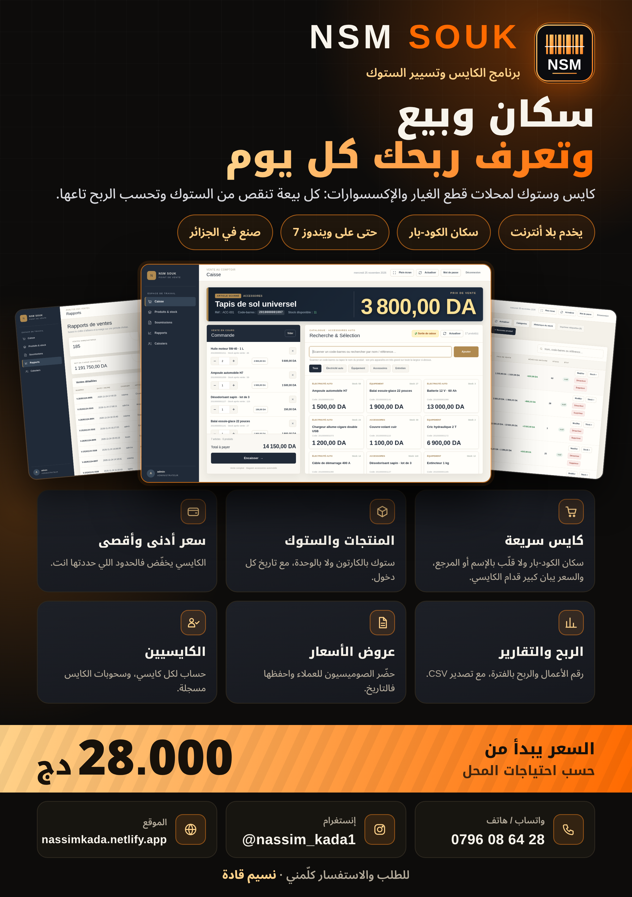

# NSM SOUK — برنامج الكايس وتسيير الستوك

**سكان وبيع وتعرف ربحك كل يوم.** كايس وتسيير ستوك لمحلات قطع الغيار والإكسسوارات: كل بيعة تنقص من الستوك وتحسب الربح تاعها، والتقارير جاهزة.

---

## واش هو NSM SOUK؟

برنامج كمبيوتر يخدم **بلا أنترنت**، والمعلومات كاملة تبقى فالكمبيوتر تاعك فقاعدة محلية، مع **نسخة احتياطية** بسيطة. يخدم **حتى على ويندوز 7**.

## المميزات

- **كايس سريعة**: سكان الكود-بار ولا قلّب بالإسم أو المرجع. السعر يبان كبير قدام الكايسي، والكايسي يخفّض فالحدود (أدنى/أقصى) اللي حددتها انت.
- **المنتجات والستوك**: أضف، عدّل ولا عطّل منتج. ستوك بالكارتون ولا بالوحدة، مع تاريخ كل دخول وتصحيحات الستوك.
- **طباعة الكود-بار**: اطبع ملصقات الكود-بار للمنتجات بسعرها.
- **التقارير**: رقم الأعمال، الربح (marge) وترتيب المبيعات حسب الفترة، مع تصدير CSV.
- **عروض الأسعار (Soumissions)**: حضّر عروض الأسعار للعملاء واحفظها، وتلقاها كاملة فتاريخ العروض.
- **الكايسيين وسحوبات الكايس**: حساب لكل كايسي، وكل سحب من الكايس يتسجل بالمبلغ والسبب.

## صور من البرنامج

> المعلومات اللي فالصور تجريبية (أسماء وأرقام مش حقيقية).

### تسجيل الدخول
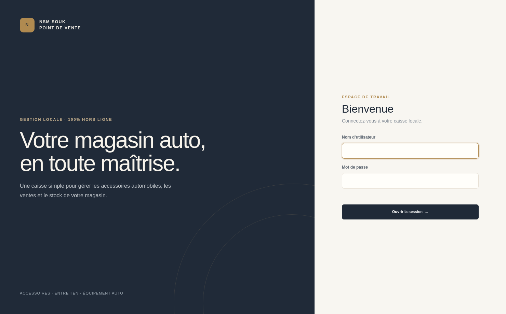

### الكايس: سكان وبيع
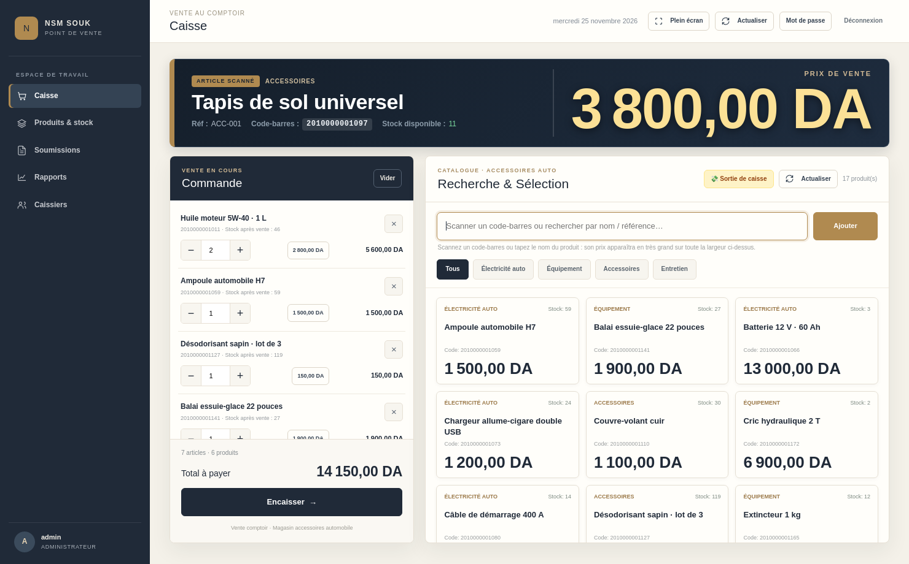

### بحث سريع وتصفية بالفئة
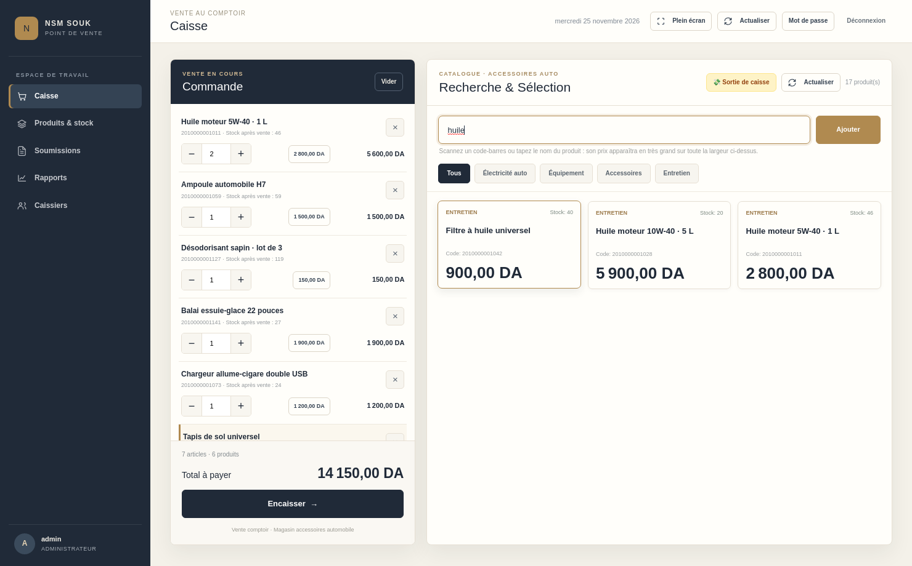

### المنتجات والستوك
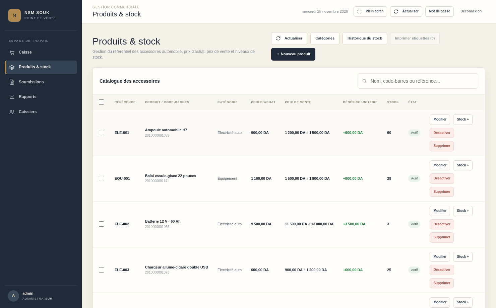

### بطاقة المنتج: أسعار وستوك
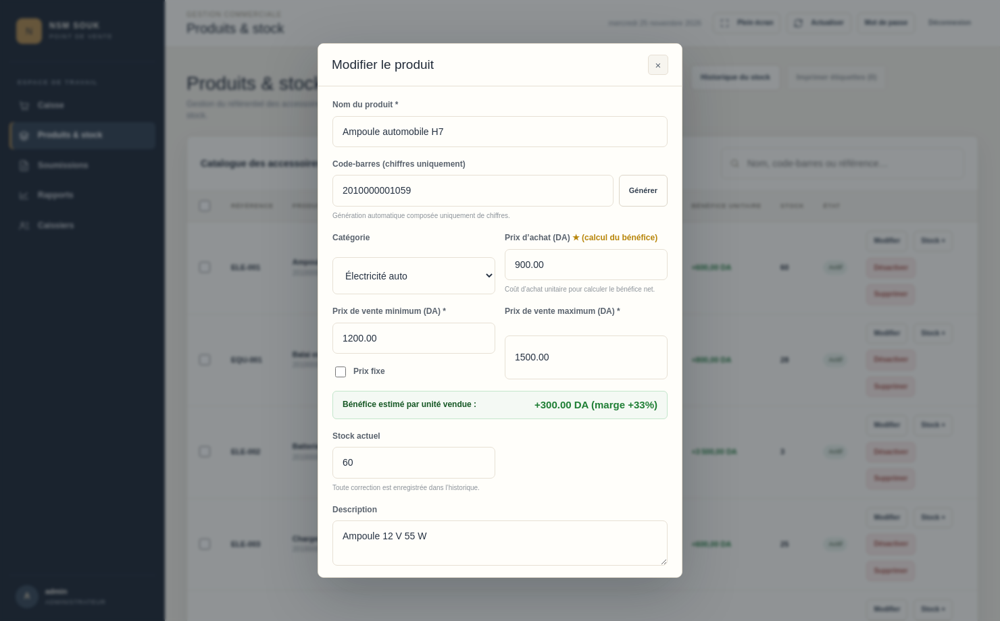

### طباعة الكود-بار
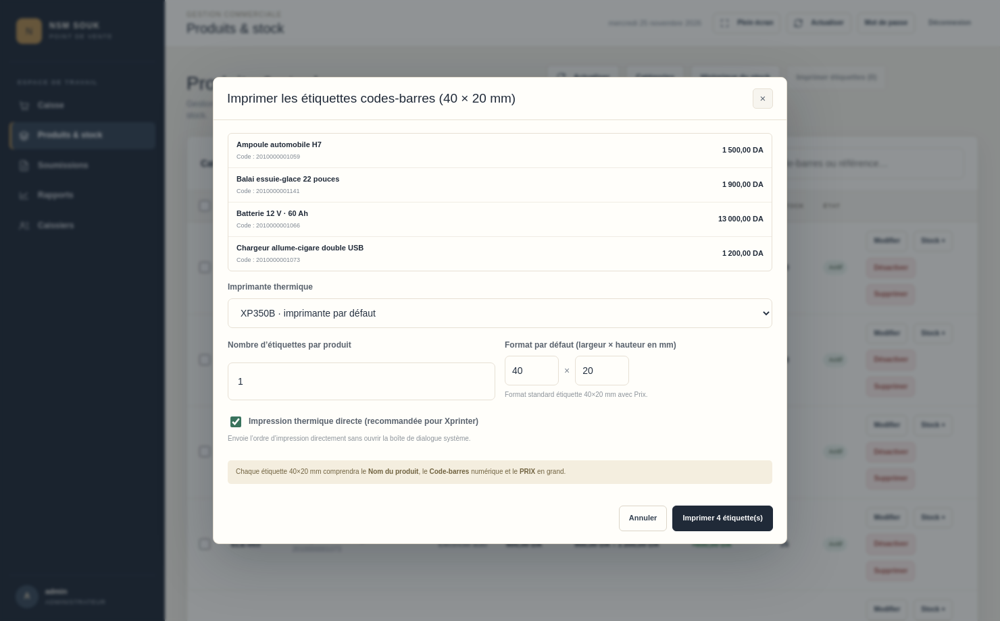

### تاريخ دخول الستوك
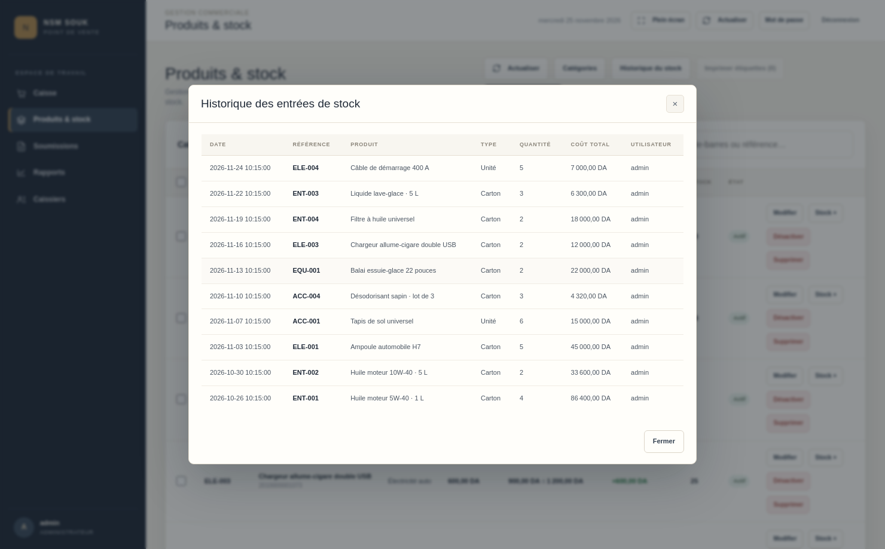

### التقارير: رقم الأعمال والربح
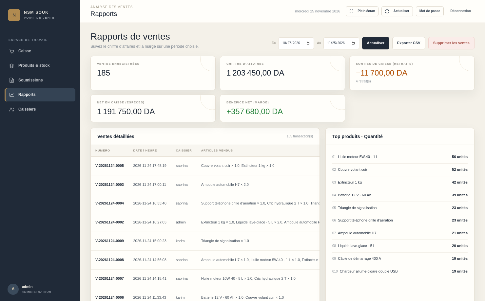

### عروض الأسعار (Soumissions)
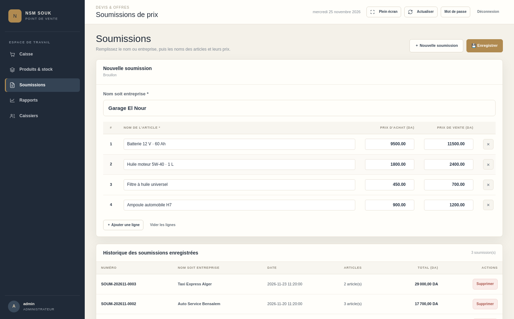

### الكايسيين
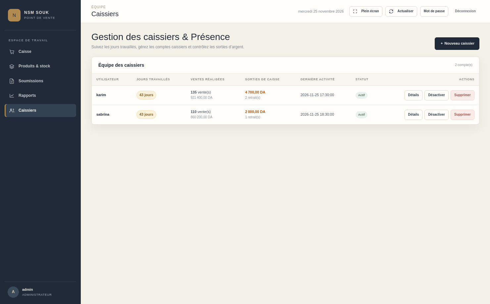

### تفاصيل الكايسي
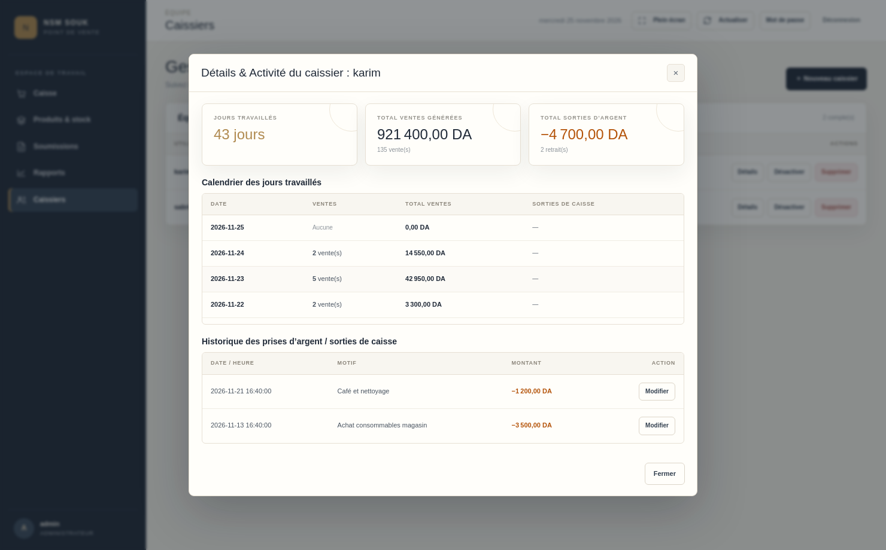

---

## السعر يبدأ من

<h2 align="center">28.000 دج</h2>

<b>حسب احتياجات المحل</b>

---

## للطلب والاستفسار

كلّمني على **نسيم قادة**:

- واتساب / هاتف: [**0796 08 64 28**](https://wa.me/213796086428)
- إنستغرام: [**@nassim_kada1**](https://instagram.com/nassim_kada1)
- الموقع: [**nassimkada.netlify.app**](https://nassimkada.netlify.app)

